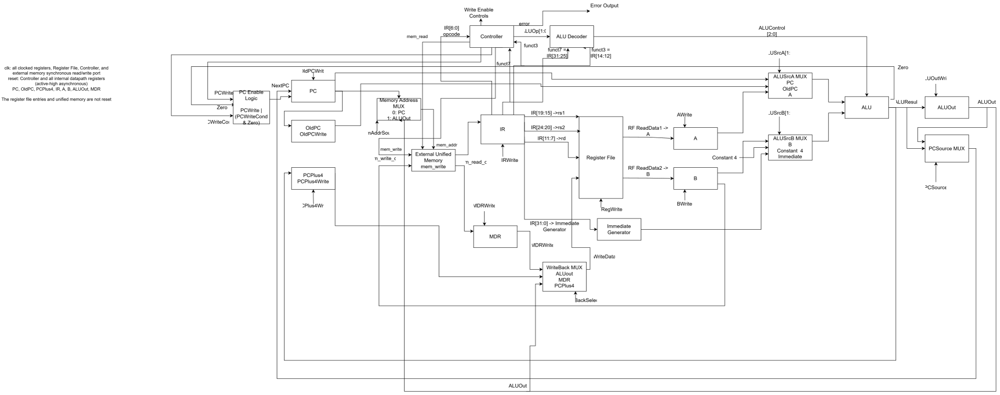

# System architecture

The [integrated top](../../rtl/system/opencorex_pim_subsystem.sv) connects a multicycle CPU and a single-lane matrix–vector accelerator to shared RAM. CPU loads and stores reach either RAM or the accelerator's MMIO page through the address router. The accelerator streams matrix words from RAM and holds one vector in its private buffer.

## CPU

The [core](../../rtl/cpu/opencorex_core.sv) implements a subset of RV32 with scalar MUL and a custom MAC. The MAC reads the old destination, adds the low 32 bits of the product, and writes back once. It uses the existing ALU and register-file ports across multiple cycles. The optional instruction cache is disabled by default. CPU data accesses go to shared memory.

[Editable CPU diagram](diagrams/opencorex-datapath.drawio) · [MAC encoding and timing](cpu-mac-extension.md)

## Accelerator

A blocking command validates the descriptor, then computes one dot product per matrix column. Each command starts with a fresh accumulator. A cold command fills the vector buffer. A warm command can reuse the resident vector when its address and length match. Results are stored back to RAM as 32-bit modular sums.

The default top has 1,024 RAM words, a 16-word vector buffer, and up to 32 outputs per command. The CIFAR studies configure 128 vector words and up to 128 outputs per command. Larger workflows tile or chunk work in software.

See the [MMIO and memory interface](mmio-memory.md) for the programming contract. The original [CPU](architecture-v0.1.md), [memory](memory-interface-v0.1.md), and [accelerator](pim-architecture-v0.1.md) designs document earlier decisions.
