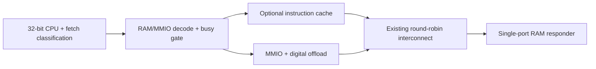

# Executable 16×32 comparison contract

All rows use the same signed 32-bit operands initially in the same single-port
RAM. Host placement is excluded. These historical rows use cache bypass. The current PIM
is a separate digital MAC with an SRAM vector buffer, not in-array CIM.

| Role / program | Whole-program cycles | START → final output cycles | CPU instruction fetches | Vector RAM reads | Matrix RAM reads | Output RAM writes |
|---|---:|---:|---:|---:|---:|---:|
| Looped, memory-based CPU: general reference | 23,685 | — | 4,327 | 512 | 512 | 32 |
| Unrolled streaming CPU: control experiment | 13,290 | — | 2,248 | 512 | 512 | 32 |
| Register-resident CPU: strongest implemented comparator for this 16×32 workload | 9,818 | — | 1,752 | 16 | 512 | 32 |
| Existing 32-bit CPU-driven PIM offload | 4,272 | 4,141 | 25 | 16 | 512 | 32 |
| Two-command PIM cold fill | shared 8,452 total | 4,141 | shared 31 total | 16 | 512 | 32 |
| Two-command PIM warm reuse | shared 8,452 total | 4,140 | shared 31 total | 0 | 512 | 32 |

Whole-program clocks start at reset release and include acceptance of the
RKYC completion store. START → final output is final accepted output edge
minus accepted START edge; setup and status handling are outside it.
The two-command total is not a per-command whole-program measurement.

Evidence: [looped subsystem test](../../tb/benchmarks/opencorex_matvec_subsystem_tb.sv),
[diagnostics](../../tb/benchmarks/opencorex_matvec_diagnostic_tb.sv),
[offload](../../tb/benchmarks/opencorex_pim_offload_tb.sv), and
[cold/warm](../../tb/benchmarks/opencorex_pim_cold_warm_tb.sv).
The diagnostics run both direct-core and shared-subsystem paths.
Every run checks all 32 outputs and unchanged inputs; instruction and traffic
counts stop at completion and exclude testbench inspection. Each CPU program
also reads one signature word and writes one completion word; offload programs
also read a RAM MMIO-base literal. MMIO control traffic is separate.

At one-cycle RAM latency, eliminating 16 vector reads saves only one PIM
execution cycle. This is the hypothesis to test under matched read-response
delays, not evidence that traffic has no cost under other memory assumptions.
Warm reuse requires a prior successful fill without reset or invalidation.

These workload-specific cycles do not establish energy, area, or physical
clock-time superiority. The CPU programs have different control flow and
register reuse; the 4,141-cycle execution boundary cannot replace the 4,272-cycle
whole-program comparator. Packed signed-8-bit and matrix-resident CIM variants
require separately matched arithmetic, residency, and physical characterization.

## October 19 instruction-cache contract — settled October 7

Question: what whole-program advantage remains for the existing 32-bit digital
offload over the resident CPU after the agreed instruction-cache intervention?
A reduced, absent or reversed advantage is valid. This is digital MAC offload,
not D8 or CIM.

Primary matrix: resident CPU / one-command cold offload × bypass / enabled ×
uniform backing-read L={1,2,5,10,20}: 20 runs. Programs, operands, arithmetic,
4 KiB single-port RAM, one outstanding read, arbitration, accepted-write timing,
one MAC lane, vector-buffer capacity and blocking execution remain fixed.
Reset cache and vector validity per run. Cache policy is identical on both CPU
paths. The looped CPU remains a secondary reference.

Topology for the integrated offload path:

The CPU-only subsystem uses the same cache before its interconnect, with PIM
idle for this comparison. Responses return through captured ownership.

Cache: 512 data bytes, direct-mapped, 32 lines of 16 bytes. Word [3:2],
index [8:4], tag [31:9]. Explicit fetch classification comes from CPU controls,
not addresses. Cache follows RAM decode and busy gating, before arbitration;
MMIO and data bypass it. No prefetch, early restart, burst, LRU or LFU.
Registered lookup: CPU acceptance t; lookup t+1; hit response consumption t+2.
Miss: first backing acceptance no earlier than t+2; four ascending word reads
from aligned line base; each response follows its acceptance by L edges.
Next read acceptance is no earlier than the edge after the preceding response.
Final refill response r produces CPU consumption at r+1. Full-line validity
appears only after the last word. No second CPU request during its pending read.
Bypass preserves existing timing. Reset cancels pending state and validity
without clearing RAM. Code is immutable; measured-run writes to executable
regions fail. Adjacent refill words are not dynamic instruction fetches.

Whole-program boundary: reset release through accepted RKYC completion store,
inclusive. Include setup, launch, wait and status; exclude host placement and
downstream result consumption. START-to-final-output remains secondary.

Measure dynamic fetches, hits/misses, refill words, all operand/other RAM/MMIO
traffic, arithmetic events, backpressure, response waits, busy and disjoint CPU
states. Report CPU/offload ratios and cycle gaps for bypass/cache at every L;
gap change equals CPU cache benefit minus offload cache benefit. Label overlapping
counters. This intervention combines reuse, spatial refill and lookup overhead.

Acceptance: 20 correct runs; unchanged inputs; bypass reproduces old uniform
records; fetches 1752/25; fetches=hits+misses; refill reads=4*misses; 16 vector
reads, 512 matrix reads and 32 output writes per method; 512 CPU MUL/accumulating
ADD pairs or 512 offload MACs. Independent trace replay predicts misses/refills.
Verify exact response timing, every word offset, conflicts, stalls, data/MMIO
bypass, busy suppression and reset during lookup/refill/response. Reconcile
cycle costs; neither L=1 equality nor hits*(L-1) savings applies to this design.
Retain commands, raw evidence, source identity and full regression results.
No fused-MAC causal claim without a separate intervention; no physical claims.

Implementation is authorized by the explicit implement-plan request. Scaling,
associativity, CPU MAC, D8 and CIM remain separate follow-ups. Scaling first
requires reviewing RAM capacity and register-residency fairness.

Measured cache evidence: [20-run results](cache-results/README.md), including
independent fetch traces, raw state/event counters and source provenance.

Verification completed October 7, 2026 with `make verify`: 35 positive
testbenches, four CPU diagnostics, 50 historical latency configurations,
20 cache-study configurations and all expected-failure checks passed.
Full local log: `obj_dir/verification/cache_study/full-verify.log`.
The measured source identity is recorded in `cache-results/provenance.json`;
the cache implementation was committed as `7fb74d05590936d15dd8e1cc55dc638dd2b27929`
on `feature/oct19-cache-study`.

The separate [output-count scaling study](scaling-results/README.md) preserves
these historical results and uses its own relocated baseline and fixed configuration.
