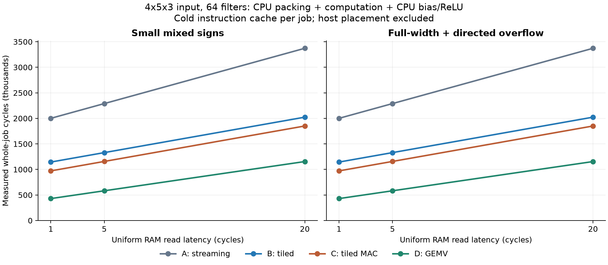
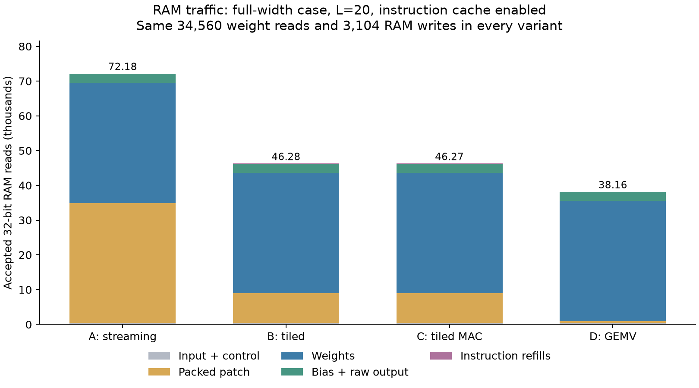
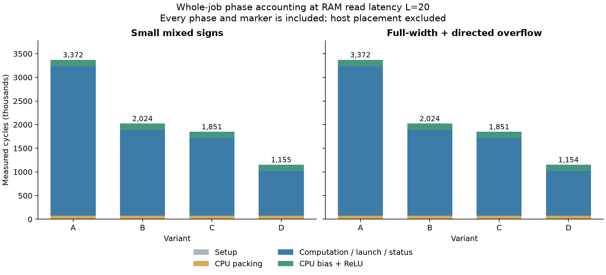

# VGG conv1_1: measured CPU and GEMV comparison

Existing GEMV completes this small packed-patch pipeline **2.262x
faster than tiled CPU MAC at L=1** and **1.603x at L=20**.
Measured RTL cycles include CPU packing, launch/status handling and software
bias/ReLU. Host placement is excluded. Workload: 4x5x3 input, 64 filters,
stride 1 and one-pixel zero padding.

[Mapping contract](../vgg-conv1_1-mapping.md) · [Measured CSV](programs.csv) ·
[CPU states](states.csv) · [Command intervals](commands.csv) ·
[Proof receipt](proof.json) · [Source/command provenance](provenance.json)

## Whole-job results

A computes one filter at a time with MUL+ADD. B holds four sums in registers,
sharing each input load. C keeps B's reuse and uses the existing MAC instruction.
D uses blocking GEMV. CPU packs inputs and applies bias/ReLU in every variant.
The hardware is identical in all runs.

| Case | RAM latency | A cycles | B cycles | C cycles | D cycles | C / D |
|---|---:|---:|---:|---:|---:|---:|
| small | 1 | 2,000,812 | 1,144,524 | 971,716 | 429,560 | 2.262x |
| small | 5 | 2,289,528 | 1,329,624 | 1,156,800 | 582,200 | 1.987x |
| small | 20 | 3,372,213 | 2,023,749 | 1,850,865 | 1,154,600 | 1.603x |
| wrap | 1 | 2,000,698 | 1,144,410 | 971,602 | 429,446 | 2.262x |
| wrap | 5 | 2,289,414 | 1,329,510 | 1,156,686 | 582,086 | 1.987x |
| wrap | 20 | 3,372,099 | 2,023,635 | 1,850,751 | 1,154,486 | 1.603x |

## Why the methods differ

**Tiling reduces repeated input reads.** B reduces patch reads from 34,560 to
8,640; weight reads stay at 34,560. At L=20, B is 1.666x
faster than A. Four sums stay in registers without partial-sum spills;
64 filters divide evenly into tiles of four.

**MAC fusion reduces instruction overhead.** C removes exactly 34,560 CPU
instructions relative to B without changing operand reads. Measured savings
are 172,808, 172,824 and 172,884 cycles at L=1,5,20: five cycles per product,
plus one avoided instruction-cache miss (4+4*L cycles). At L=20 it reduces B's
job time by 8.54%. Unchanged data-read waits
reduce fusion's relative benefit as latency rises.

**Offload reuses the entire patch privately.** D reads 27 shared-RAM patch
words per command, or 540 across 20 commands, and reuses them across filters.
Its 128-word private buffer exceeds the CPU register budget. D/C combines
storage, traffic and control advantages; it is not a pure arithmetic comparison.

| Variant | Patch reads | Weight reads | CPU instructions (wrap) | Total RAM reads |
|---|---:|---:|---:|---:|
| A: streaming | 34,560 | 34,560 | 309,390 | 72,179 |
| B: tiled MUL+ADD | 8,640 | 34,560 | 175,310 | 46,275 |
| C: tiled MAC | 8,640 | 34,560 | 140,750 | 46,271 |
| D: GEMV + CPU | 540 | 34,560 | 24,211 | 38,160 |

Every variant also performs 390 input reads during packing, 540 patch writes,
1,280 bias reads and 1,280 raw-output reads. All have 3,104 RAM writes:
540 packed entries + 1,280 raw outputs + 1,280 final outputs + three phase
markers + one completion. Refills and literal/signature reads are separate.

Weights occupy 6,912 bytes but are read 20 times: 138,240 bytes. They account
for 98.46% of D's accelerator operand reads. This remaining
traffic explains the falling offload speedup at higher latency. Avoiding it
requires a separate weight-residency/reuse model.

## Packing and output processing count

The CPU nested-loop packer checks bounds at runtime and materializes all
20 patches (2,160 bytes): 390 entries read the image, 150 supply padding zeros.
All variants compute 34,560 products, including 9,600 padding-zero products,
then update the single output allocation in place during software bias/ReLU.

| L=20, wrap case | Setup | CPU packing | Computation | CPU bias/ReLU | Whole job |
|---|---:|---:|---:|---:|---:|
| A: streaming | 186 | 70,938 | 3,165,459 | 135,516 | 3,372,099 |
| B: tiled MUL+ADD | 186 | 70,938 | 1,816,995 | 135,516 | 2,023,635 |
| C: tiled MAC | 186 | 70,938 | 1,644,111 | 135,516 | 1,850,751 |
| D: GEMV + CPU | 186 | 70,938 | 947,762 | 135,600 | 1,154,486 |

For D at L=20, packing occupies 6.14% and
bias/ReLU 11.75% of job time. Their combined share
at L=1 is 34.71%.
D's slightly longer postprocessing is one extra instruction-cache miss due to
code placement, with identical output-processing logic.

## Proof and limits

Both datasets passed four variants at three latencies: **24 RTL runs**,
**92,160 raw/biased/final comparisons**, and 12,960 packed-entry checks.
The direct Python tensor reference shares no packing or serialized-weight
indexing with the mapped model. Independent RV32 execution matches every
accepted instruction address and cache hit/miss. The harness checks RAM
counts/order, descriptors, blocking, response ownership, vector freshness,
immutable input/weights/biases, completion and disjoint phase/state totals.
Two injected faults are rejected: a code write and a corrupted bias.

At position (1,1), the wrap case tests INT_MAX + bias 1 becoming INT_MIN and
ReLU zero; another filter tests INT_MIN + bias -1 becoming INT_MAX.
Checking biased words before ReLU prevents clipping from hiding errors.
Datasets differ by 114 cycles per matching configuration because their
negative-output counts differ by 19 conditional CPU instructions.

Full make verify also passed; see [verification receipt](verification.json).

Host generator/reference work took 0.0939 seconds in this
run, outside simulated cycles. Immutable operands occupy 7,408 bytes; complete
image text is 34,119-34,263 bytes including code and poisoned scratch/output
regions. These sizes are not physical transfer-time estimates. Initial
placement, upstream conversion, physical transfer and downstream consumption
are unmeasured. Native filter-first weights need no conversion.

These CPU baselines use the same packed-patch pipeline, rather than an optimized
direct convolution. A direct CPU version could avoid materialization and
padding-zero products; CPU kernels could also fuse bias/ReLU before their
first store. Those are useful next comparisons. Full-sized layers need a
separate RAM capacity, tiling and residency model. There is no clock-frequency,
area, energy or full-VGG speedup result. Production defaults and historical
measurements are unchanged.

## Reproduce

From the repository root in WSL Ubuntu:

~~~sh
make conv1-proof
make conv1-study
make conv1-audit
make conv1-plot
python3 scripts/analyze_conv1.py
make verify
~~~

Images, logs, exact traces and builds are generated under
obj_dir/verification/conv1/. Audit checks retained local evidence and source
identities; a fresh checkout must run the study first. Plotting needs matplotlib
and can reuse obj_dir/tiling-plot-packages/ when present. CSVs, receipts and
PNG/SVG graphs are saved here. The existing shared regression runs through
make verify; the new focused harness runs through conv1-study.
