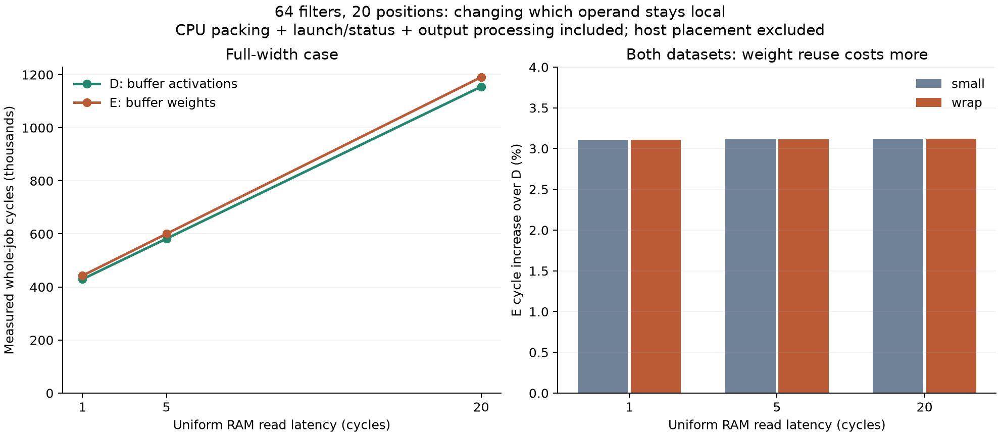
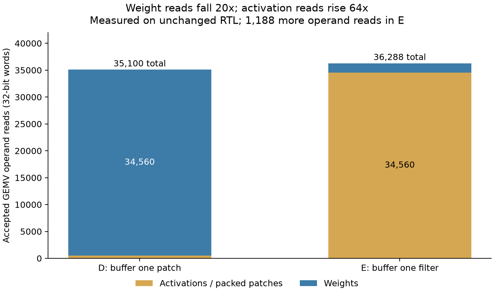
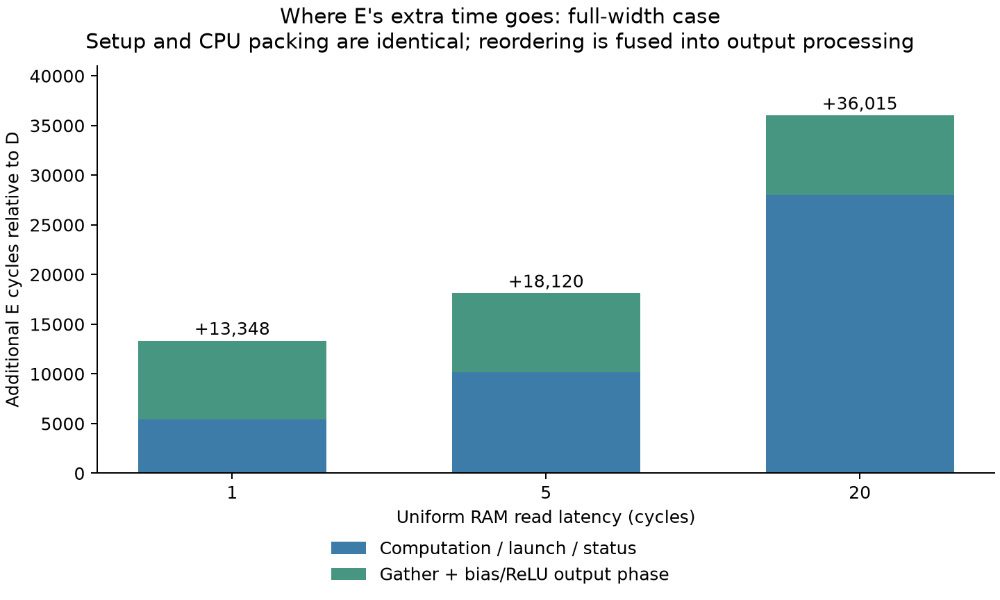

# Conv1_1 weight reuse: fewer weight reads, more total work

For this 4x5 input, **buffering weights takes 3.11-3.12% more cycles** than
buffering activations. Weight reads fall 20x, but activation reads rise 64x,
and E launches 64 commands instead of 20. Both use unchanged accelerator RTL.
This is a measured dataflow comparison for 64 filters and 20 positions.

[Mapping and costs](../vgg-conv1_1-weight-reuse.md) ·
[Original A-D study](../conv1-results/README.md) · [E measurements](programs.csv) ·
[Computed comparisons](comparison.json) · [Proof](proof.json) ·
[Source/command provenance](provenance.json)

## Whole-job comparison

D retains one 27-value patch while streaming 64 filters. E retains one
filter's 27 weights while streaming 20 patches. All tensors, arithmetic,
padding, software bias/ReLU and runtime patch packing match the original study.
Timing includes reset release through accepted completion. Host placement is excluded.

| Case | RAM latency | D cycles | E cycles | Extra cycles | E increase |
|---|---:|---:|---:|---:|---:|
| small | 1 | 429,560 | 442,908 | 13,348 | 3.11% |
| small | 5 | 582,200 | 600,320 | 18,120 | 3.11% |
| small | 20 | 1,154,600 | 1,190,615 | 36,015 | 3.12% |
| wrap | 1 | 429,446 | 442,794 | 13,348 | 3.11% |
| wrap | 5 | 582,086 | 600,206 | 18,120 | 3.11% |
| wrap | 20 | 1,154,486 | 1,190,501 | 36,015 | 3.12% |

## Reuse trades one stream for another

| Shared-RAM activity | D: activation reuse | E: weight reuse |
|---|---:|---:|
| Patch reads during GEMV | 540 | 34,560 |
| Weight reads during GEMV | 34,560 | 1,728 |
| GEMV operand reads | 35,100 | 36,288 |
| Commands and status reads | 20 | 64 |
| MMIO writes | 140 | 448 |
| All RAM reads, including instruction refills | 38,160 | 39,353 |
| All RAM writes | 3,104 | 3,104 |
| CPU instructions, wrap case | 24,211 | 26,324 |
| Data allocation, excluding code/control/private buffer | 14,688 bytes | 19,808 bytes |

E saves 32,832 weight reads but adds 34,020 activation reads: 1,188 more
GEMV reads. One extra instruction-cache miss adds four refill reads, and
one additional literal read brings the total RAM difference to 1,193.
The 128-word private vector buffer is identical in both methods; E stores
one filter locally, not all 64 filters.

For K input terms, P positions and F filters, D reads K*P + K*P*F operands;
E reads K*F + K*P*F. Their difference is K*(F-P). Here that is
27*(64-20)=1,188. Weight reuse saves operands when P exceeds F, but this is
an analytical traffic crossover, not a measured performance result for larger
images. Command limits, output layout and capacity still matter.

## Output conversion is counted, without a separate copy pass

E writes raw values filter-first into a separate 5,120-byte allocation.
The CPU gathers them in position-first order while adding bias and applying
ReLU. It performs the same 1,280 raw reads, 1,280 bias reads and 1,280 final
stores as D; extra work is address/control instructions, not another RAM copy.
Biases are deliberately read per output in both methods.

E executes 2,113 more CPU instructions: 792 from 44 additional command-loop
iterations, and 1,321 from gathering/output setup. This includes 1,280 extra
source/destination pointer updates, 40 position-loop instructions and one load.
Output-phase differences include cache/code-placement effects and therefore
are not a standalone conversion benchmark.

| L=20, wrap case | Setup | Packing | Computation | Output processing | Whole job |
|---|---:|---:|---:|---:|---:|
| D | 186 | 70,938 | 947,762 | 135,600 | 1,154,486 |
| E | 186 | 70,938 | 975,746 | 143,631 | 1,190,501 |

At L=1 E adds 5,412 compute-phase cycles and 7,936 output-phase cycles.
At L=20 the differences are 27,984 and 8,031 cycles. Packing and setup match.
Across both datasets the exact measured identity is
E-D = 13,348 + 1,193*(L-1): additional RAM latency accounts for the growing
absolute gap while base instruction/control work accounts for the intercept.

## Proof, provenance and limits

Six E RTL runs passed across both datasets and L=1,5,20: 23,040 raw/biased/final
comparisons, 7,680 gathered-raw checks and 3,240 packed-entry checks.
Independent RV32 execution matches every accepted instruction/cache event.
The harness checks raw filter-first stores, gathered addresses and values,
canonical final outputs, memory ownership, CPU blocking, descriptors, status,
buffer residency and immutable inputs/weights/biases. Code-write, corrupted-bias
and wrong-gather faults are all rejected. Both mappings use the same independent
direct Python tensor reference, including directed overflow before ReLU.

Original A-D source and image identities and saved measurement hashes are
checked before comparison. Its evidence files and scripts are unchanged.
E results and logs are stored separately. Full make verify passed; see [receipt](verification.json).

The CPU packer is byte-identical through its phase marker, ensuring equal
runtime packing. E uses the existing 128-word/128-output benchmark parameters;
production defaults are unchanged. Host generator/reference work took
0.3570 seconds here, excluded from RTL cycles.
Initial placement, physical transfers, upstream conversion and downstream
consumption remain unmeasured. These results say nothing about full-VGG
performance, frequency, area or energy.

Next useful experiment: vary spatial positions around the 64-filter traffic
crossover while keeping explicit output-conversion and capacity accounting.
Beyond 128 positions, E must split output commands and model filter reuse
across those commands; larger-layer claims require that separate study.

## Reproduce

From the repository root in WSL:

~~~sh
make conv1-weight-reuse-proof
make conv1-weight-reuse-study
make conv1-weight-reuse-audit
make conv1-weight-reuse-plot
make verify
~~~

A-D data is already recorded in the original results directory. E verifies
those source/measurement identities and does not rerun or overwrite A-D results.
Generated images, logs and exact traces live under
obj_dir/verification/conv1_weight_reuse/. Auditing requires those retained local
artifacts; a fresh checkout should run the study first. Plotting uses matplotlib
and can reuse the existing obj_dir/tiling-plot-packages/ installation.
