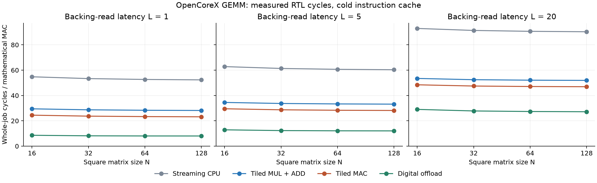

# CPU MAC fusion: measured square GEMM — October 25, 2026

At 128×128/L=20, MAC reduces tiled CPU cycles by
**9.63%**
(1.1066× speedup). Digital offload retains
**1.7271×** advantage, versus
1.9111× against tiled MUL+ADD.
Fusion removes instruction overhead without reducing operand traffic.

## Architecture

[Standalone ISA contract and alternatives](../../architecture/cpu-mac-extension.md):
custom-0 opcode 0x0b, funct7=1, funct3=0;
`rd = old(rd) + rs1*rs2 mod 2^32`. Signed/unsigned low products are identical;
no widening or saturation. Software initializes rd; x0 stays zero.

Keep two read ports and the existing ALU. DECODE captures rs1/rs2; R_EXEC saves
the product in ALUOut; new MAC_ACCUM reads rd through port 1 and adds it to
ALUOut; ordinary writeback commits once. Two mux inputs and a read-address mux
are added, with no new arithmetic unit, temporary register or interface.
Existing state IDs 0–15 stay fixed; state 16 is appended.

Minimum MAC latency is six cycles versus five for MUL alone, or ten for a
MUL+ADD pair. Cached hits make those seven versus twelve. The extra state
serializes multiply and add on the existing ALU. A third read port adds a wide
read mux and accumulator latch; it saves a state only with an additional
multiply-plus-add datapath, costing an adder and a longer critical path.
Sharing the existing adder still needs two arithmetic states.

## Verification

Final `make verify`: **36 positive testbenches, 50 latency configurations,
20 cache configurations, 19 expected-failure cases; zero unexpected failures**.
Controller decode exhausts 131,072 field combinations: 1,671 legal / 129,401 illegal.
Whole-core MAC tests execute 76 arithmetic programs / 152 dependent MACs and
three reset-abort phases. They cover signs, zero, initialization, wrapping,
aliases, x0, mixed instructions, state timing, single writeback and sticky errors.
GEMM exercises stalled memory/cache and branches.

Development checks exposed an obsolete reserved-mux assertion and historical
source-identity enforcement. The assertion now checks MAC mux semantics.
Cache regression uses explicit `--allow-source-changes`: all historical counters,
states and traces still must match exactly; current source hashes are recorded
separately. Ordinary `--check` retains strict source identity. Historical evidence
and architecture-v0.1.md are unchanged. [Verification receipt](verification.json).

## Controlled configuration

**48 actual RTL runs:** N=16/32/64/128, L=1/5/20, four methods, cache enabled.
All A/B/D program/cache counters exactly reproduce historical GEMM records.
Every output is checked (261,120 across runs), inputs remain unchanged, and
accepted instruction/miss traces match independent Python execution byte for byte.
[Measurements](programs.csv), [disjoint states](states.csv),
[source/commands](provenance.json), [raw-log identities](logs.csv).

Same full-width operands, row-major A/C, column-major B, address map, 1 MiB RAM,
one outstanding read, accepted stores and uniform fetch/data latency. The existing
512-byte direct-mapped instruction cache has two-cycle hits and four serial refill
reads. Each job starts with cold cache/PIM metadata; cache remains live between
cold PIM row commands. Timing is reset release through accepted completion store,
inclusive. Host placement, conversion and downstream consumption are excluded.
No CPU data cache. B/C loop order, tiling, operand addresses and stores match.

### L=20 whole-job cycles

A: streaming CPU; B: tiled MUL+ADD; C: tiled MAC; D: existing digital offload.

| N | A cycles | B cycles | C cycles | D cycles | B/C | C/D |
|---:|---:|---:|---:|---:|---:|---:|
| 16 | 380,724 | 219,012 | 198,448 | 118,895 | 1.1036 | 1.6691 |
| 32 | 2,993,940 | 1,719,396 | 1,555,472 | 910,703 | 1.1054 | 1.7080 |
| 64 | 23,767,764 | 13,655,076 | 12,344,272 | 7,169,903 | 1.1062 | 1.7217 |
| 128 | 189,436,500 | 108,876,708 | 98,390,864 | 56,970,095 | 1.1066 | 1.7271 |

### Instructions and external RAM traffic at L=20

RAM writes include N² output stores plus one completion; no spills.
RAM reads include instruction refills, five CPU literals and one signature.
MMIO remains separately counted in the CSV.

| N | B instructions | C instructions | C A reads | C B reads | RAM reads B/C | RAM writes B=C |
|---:|---:|---:|---:|---:|---:|---:|
| 16 | 18,393 | 14,297 | 1,024 | 4,096 | 5,174/5,170 | 257 |
| 32 | 143,017 | 110,249 | 8,192 | 32,768 | 41,014/41,010 | 1,025 |
| 64 | 1,128,777 | 866,633 | 65,536 | 262,144 | 327,734/327,730 | 4,097 |
| 128 | 8,970,889 | 6,873,737 | 524,288 | 2,097,152 | 2,621,494/2,621,490 | 16,385 |

All methods read N³ B elements and write N² outputs. A reads are
N³ / N³÷4 / N³÷4 / N² for A/B/C/D. D also executes N cold commands,
7N MMIO writes and N status reads, retaining an explicit private-buffer reuse
advantage over both CPUs.

### N=128 latency sensitivity

| L | B cycles/MAC | C cycles/MAC | D cycles/MAC | B/C | C/D |
|---:|---:|---:|---:|---:|---:|
| 1 | 28.1660 | 23.1660 | 8.0155 | 1.2158 | 2.8901 |
| 5 | 33.1661 | 28.1661 | 12.0471 | 1.1775 | 2.3380 |
| 20 | 51.9165 | 46.9164 | 27.1655 | 1.1066 | 1.7271 |



## Attribution and unexpected effects

One fewer instruction per product removes fetch/decode/execute/writeback work;
MAC pays one extra accumulation cycle. Net savings are five cycles/product
with cached hits. Kernel length shrinks from 45 to 41 instructions, reducing
cold misses from 12 to 11 including boot, and removing four backing reads.
All 12 B/C pairs satisfy measured savings `5*N³ + (4+4*L)` exactly.
At N=128/L=20: 10,485,760 fusion cycles plus 84 cold-cache cycles saved.
These are measured RTL cycles, not predictions from instruction counts.

C still spends **49,807,474 cycles (50.62%)**
in extra backing data-read waits at N=128/L=20, identical to B.
B is 80% of CPU operand reads and is reread for each A row.
FETCH/FETCH_CAPTURE/DECODE consume 27,495,872 cycles
(27.95%), including cache lookup/refill.
State totals are disjoint; general wait/busy counters can overlap state groups.

The B→C gain is instruction/control overhead reduction. High latency leaves
a large unchanged data-stall cost, reducing fusion's relative benefit.
Remaining CPU/PIM differences combine traffic, vector reuse and simpler control;
they cannot be attributed entirely to arithmetic or entirely to memory.

## Limits and next step

Equal clocks are assumed; added mux paths still need synthesis/timing validation.
There is no PPA/energy result. D is a digital shared-memory offload, not a measured
SRAM/RRAM in-memory device; it has a private 128-word vector buffer versus the
CPU's shared registers. B reuse across rows and layout-conversion costs remain
excluded. This sweep did not measure MAC cache bypass or L=2/10.
Historical bypass regressions exercise non-MAC workloads.

Next: synthesize baseline/MAC under identical constraints, then establish the
first VGG convolution-layer baseline with explicit packing/placement costs.
Evaluate B reuse separately.

## Reproduction and changed files

From `/home/robel/OpenCoreX` in WSL Ubuntu:

```sh
make verify
make mac-study
PYTHONPATH=obj_dir/tiling-plot-packages make mac-plot
```

Plotting requires matplotlib; the last command reuses the existing ignored local
installation. Python generates hex images/references; Verilator executes RTL.
Historical images are checked before MAC images are generated.
Logs remain under `obj_dir/verification/mac_study/`.

Developed on `feat/cpu-mac-benchmark` from main `2229972`. Modified/new sources:

- RTL: `rtl/cpu/controller.sv`, `rtl/cpu/datapath.sv`.
- Tests: `tb/cpu/controller_tb.sv`, `datapath_tb.sv`, new `opencorex_mac_tb.sv`;
  `tb/benchmarks/opencorex_gemm_large_tb.sv`.
- Scripts: `generate_gemm.py`, `generate_gemm_large.py`,
  `generate_matvec_1x16_16x32.py`, `gemm_large_trace.py`,
  new `run_mac_study.py` and `plot_mac.py`; `verify.sh`, `run_cache_study.py`.
- Integration: `Makefile`, `docs/README.md`, standalone MAC ISA document.
- Images: `programs/gemm/hex/mac_16.hex` / `mac_32.hex`;
  `programs/gemm-large/hex/mac_64.hex` / `mac_128.hex`.
- This result directory: CSVs, provenance, verification receipt and PNG/SVG plot.

Memory/cache/PIM RTL and historical v0.1 architecture are unchanged.
