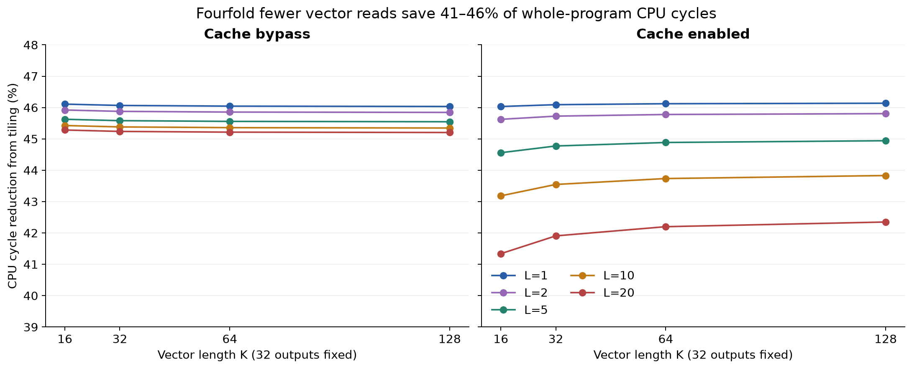
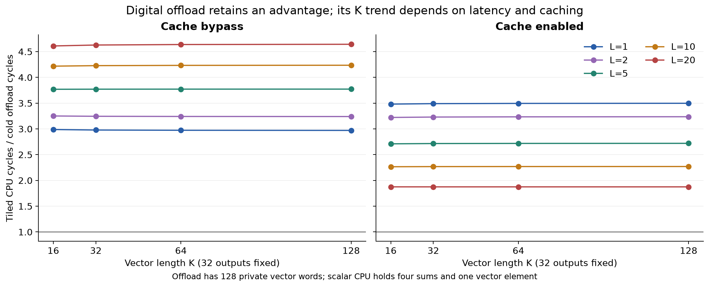

# Larger-vector output tiling — October 14, 2026

Four-output tiling reduces whole-program CPU cycles by **41.34–46.14%** across
the 40 matched CPU pairs. It removes three of four vector reads and much loop
control, while still reading every matrix weight and executing separate scalar
MUL/ADD pairs. The digital offload remains faster in all 120 configurations.

N=32; K={16,32,64,128}; streaming CPU, tiled CPU and one cold digital offload;
cache bypass/enabled; uniform backing-read L={1,2,5,10,20}. Fixed RAM=1 MiB,
BUFFER_WORDS=128, MAX_OUTPUTS=128, MAC_LANES=1. The offload's provisioned
512-byte private vector buffer can retain all 128 elements; CPU kernels share
31 writable registers and retain one vector element plus one/four sums.
This capacity advantage is part of the comparison.

The [pre-implementation contract](../tiling-contract.md) records register
allocation, loops, pointer updates, byte-address memory map and completion.
Production RTL/defaults, historical images/results and cache policy are unchanged.
There is no CPU data cache. This is digital offload, with one backing port and
one outstanding read. The instruction cache retains two-cycle hits and four
serial refill reads. Each run starts with reset validity and identical signed
32-bit operands; products and sums wrap modulo 2^32. Full-width signed boundary
values exercise overflow. Smaller K inputs prefix the maximum logical inputs;
references are calculated before column-major serialization.

## Whole-program measurements

All cycles include setup, launch/wait/status and the accepted completion store.
Host placement and downstream consumption are excluded. All 120 raw records,
including bypass, normalized cycles and both CPU/offload ratios, are in
[programs.csv](programs.csv). The table below shows cache-enabled endpoints.

| K | L | Streaming CPU | Tiled CPU | Cold offload | CPU cycle reduction | Streaming/offload | Tiled/offload |
|---:|---:|---:|---:|---:|---:|---:|---:|
| 16 | 1 | 28084 | 15156 | 4353 | 46.03% | 6.452 | 3.482 |
| 32 | 1 | 54708 | 29492 | 8449 | 46.09% | 6.475 | 3.491 |
| 64 | 1 | 107956 | 58164 | 16641 | 46.12% | 6.487 | 3.495 |
| 128 | 1 | 214452 | 115508 | 33025 | 46.14% | 6.494 | 3.498 |
| 16 | 20 | 48186 | 28266 | 15069 | 41.34% | 3.198 | 1.876 |
| 32 | 20 | 94266 | 54762 | 29197 | 41.91% | 3.229 | 1.876 |
| 64 | 20 | 186426 | 107754 | 57453 | 42.20% | 3.245 | 1.876 |
| 128 | 20 | 370746 | 213738 | 113965 | 42.35% | 3.253 | 1.875 |

As K increases, the cached tiled/offload ratio rises from 3.482 to 3.498 at
L=1, but is nearly flat, slightly decreasing from 1.875771 to 1.875471 at L=20.
With bypass it decreases from 2.988 to 2.971 at L=1 and increases from 4.610
to 4.643 at L=20. There is no single monotonic larger-vector trend across
memory/cache assumptions. At cached L=20, the absolute tiled/offload gap still
grows from 13197 to 99773 cycles. Fixed overhead amortization explains the ratio
trends; it does not eliminate the growing execution cost.

At K=128, cached L=20: streaming/tiled/offload cycles per output are
11585.8125 / 6679.3125 / 3561.40625; cycles per product are
90.514160 / 52.182129 / 27.823486.





[Whole-program endpoint figure](graphs/whole-program-cycles.png); each figure
also has an editable SVG. Regenerate with `python3 scripts/plot_tiling.py`
in a Python environment with matplotlib.

## Traffic, instructions and cycle explanation

| Per run | Streaming CPU | Tiled CPU | Cold offload |
|---|---:|---:|---:|
| Vector backing reads | 32K | 8K | K |
| Matrix backing reads | 32K | 32K | 32K |
| Output writes | 32 | 32 | 32 |
| Literal reads / signature reads | 5 / 1 | 5 / 1 | 7 / 1 |
| Completion writes | 1 | 1 | 1 |
| MMIO writes / reads | 0 / 0 | 0 / 0 | 7 / 1 |
| Scalar MULs / accumulating ADDs | 32K / 32K | 32K / 32K | 0 / 0 |
| Digital MACs | 0 | 0 | 32K |
| Dynamic fetches | 256K+232 | 136K+120 | 23 |
| Static instruction bytes, including boot and parks | 96 | 160 | 100 |
| Bytes including boot/final-line refill padding | 112 | 176 | 112 |
| Cold cache misses / refill words | 7 / 28 | 11 / 44 | 7 / 28 |

Vector reads fall fourfold, **total operand reads fall from 64K to 40K**
(37.5%), and matrix reads stay fixed. Tiling pays off despite four accumulator
initializations/stores and the matrix skip: the inner loop takes 17 instructions
for four products rather than four streaming iterations of eight instructions.
Dynamic fetches approach 46.875% fewer. The larger compact tiled kernel incurs
four more cold misses, but no capacity/conflict misses during either CPU loop.
Kernel structure and footprint stay fixed across K; three weight offsets and
one skip immediate change. These are looped kernels, with no unrolling study.

Setup/execution/completion partitions are in [phases.csv](phases.csv). CPU setup
ends before accepted fetch of the first outer-loop instruction; execution includes
that fetch through the final accepted output store; completion is the remaining
cycles through the signature store. Offload setup includes accepted START,
execution is final-output edge minus START edge, and completion follows the final
output. These phase boundaries aid explanation; whole-program time is the primary
comparator. At K=128, cache enabled, L=20:

| Method | Setup | Execution | Completion | Total |
|---|---:|---:|---:|---:|
| Streaming | 393 | 370218 | 135 | 370746 |
| Tiled | 393 | 213204 | 141 | 213738 |
| Offload | 663 | 113069 | 233 | 113965 |

[states.csv](states.csv) gives the disjoint 16-state CPU partition; its sum equals
total cycles for every row. Busy/blocking, backing waits and CPU response waits
overlap these states and must not be added to them. Offload busy is spent primarily
in the CPU FETCH stall. CPU setup and completion also include cache lookup/refill
and literal/signature read costs.

All 60 enabled-cache rows satisfy exactly
`T_cache − T_bypass = hits×(2−L) + misses×(6+3L)`.
For each fixed method/cache/K, latency growth from L=1 equals the categorized
backing-read wait growth. Caching hurts both CPUs at L=1/2, helps them at L=5/10/20,
and adds net offload fetch overhead at every tested L. These timings follow the
fixed responder/cache policy; L is not calibrated DRAM latency.

This experiment combines operand reuse, scalar control/addressing costs, digital
controller execution and explicitly unequal vector storage. It does not isolate
a MAC instruction benefit, establish the strongest possible CPU implementation,
or measure physical PPA, energy or physical clock-time performance.

## Reproduction and verification

From `/home/robel/OpenCoreX` in Ubuntu WSL:

```bash
make tiling-study
make tiling-check
make scaling-check
make verify
python3 scripts/plot_tiling.py
```

For the figures produced here, matplotlib was installed only under ignored build
output: `python3 -m pip install --target obj_dir/tiling-plot-packages matplotlib`;
the actual render command was
`PYTHONPATH=obj_dir/tiling-plot-packages python3 scripts/plot_tiling.py`.

The study/check each validate 120 primary cases, ten buffer-only compatibility
cases, three vector-length limit cases and six executable-write rejection paths.
Compatibility changes only BUFFER_WORDS from 16 to 128 on the existing relocated
K=16/N=32 offload workload: all program/cache counters, states and fetch traces
match historical scaling evidence exactly. New K=16 results are a separate
baseline with new placement/operands and two additional offload literal loads.

Every primary run checks all outputs, unchanged inputs, exact address sequences,
traffic/arithmetic counts, no spills, accepted completion, request stability,
response timing/ownership, one outstanding read, MMIO isolation and busy blocking.
K=128 checks buffer index 127: one write, 31 internal reads and the correct final
stored word; valid count represents 128 without truncation. MMIO advertises
buffer/output capacities 128 and one lane. K=0/129 reject with error 5 before
operand reads, output writes or MAC starts; valid K=128 completes.

The independent Python interpreter executes every program, checks scalar and
offload outputs, and replays each accepted fetch against the direct-mapped cache.
Its twelve `method-K-trace.csv` files match RTL fetch/miss sequences exactly.
[provenance.json](provenance.json) records measured source SHA-256 identities,
base ancestry, simulator version and every build/run command.
[verification.json](verification.json) records completed regression commands,
log hashes and unchanged historical source/evidence checks. Logs are under
`obj_dir/tiling-*.log` and `obj_dir/verification/vector_tiling/`.
